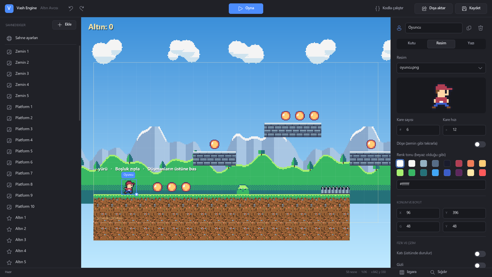
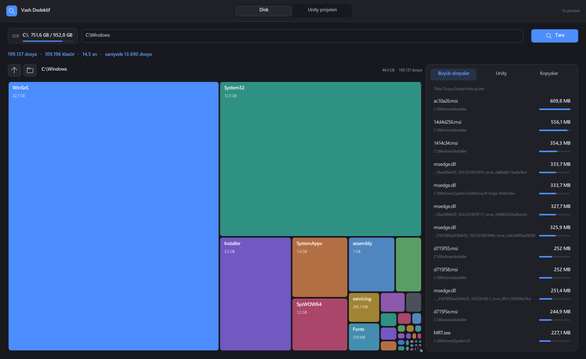
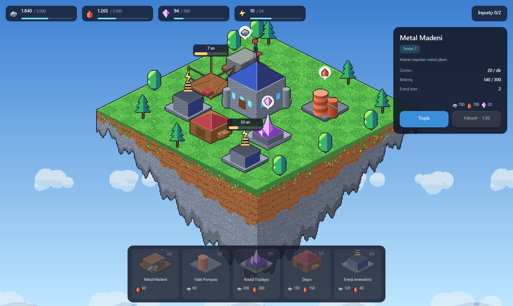
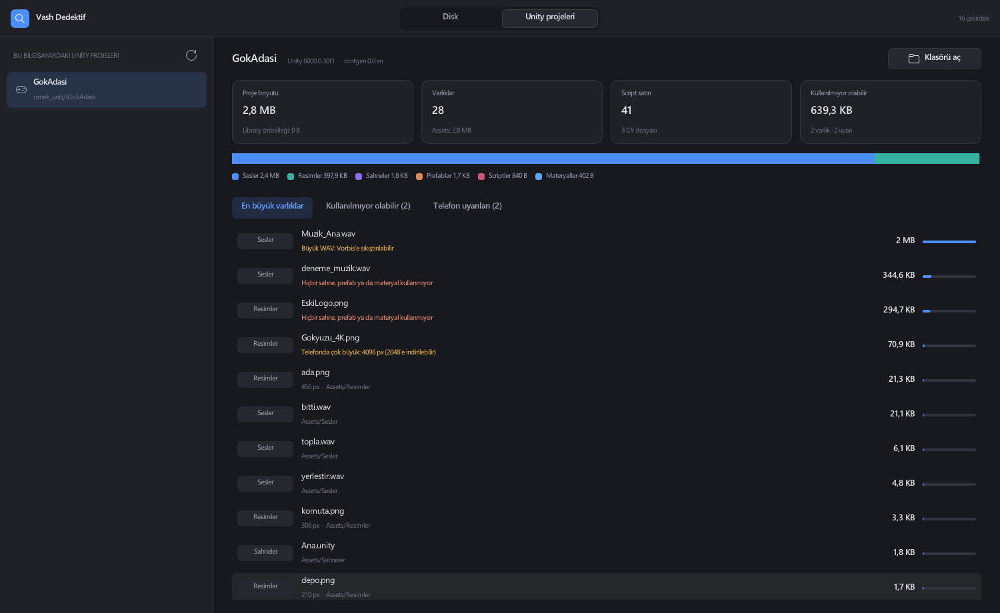

<p align="center"></p>

<h1 align="center">Vash</h1>

<p align="center"><b>Easy like Python, fast like C, safe by default.</b><br>
A compiled, general-purpose language that writes itself, with a 2D game engine, a sandbox for AI-written code, and real apps built in it.</p>

<p align="center"><a href="README.tr.md">Türkçe</a> · <a href="VASH_SPEC.md">Language spec (TR)</a> · <a href="KUM_HAVUZU.md">Sandbox</a> · <a href="vash_engine/BENIOKU.md">Vash Engine</a></p>

> **Status: experimental.** Windows only for now. The compiler compiles itself and passes its test suite,
> but the language and its standard library may still change.

```vash
type Product {
    name: text
    price: float
    stock: int = 0

    fn value() -> float {
        return price * float(stock)
    }
}

fn parse_price(t: text) -> float fails {
    var p = float(t, else: -1.0)
    if p < 0.0 {
        fail "not a price: {t}"
    }
    return p
}

fn save(report: text) -> bool {
    use files                                   # without this line: compile error
    return write_file("report.txt", report)
}

var products = [Product(name: "apple", price: 4.5, stock: 30), Product(name: "pear", price: 6.0, stock: 12)]
products.add(Product(name: "banana", price: try parse_price("9.75"), stock: 25))
products.sort(by: fn(a, b) => a.value() > b.value())
print("top:", products[1].name)

var total = 0
parallel repeat i from 1 to 100000000 {
    total = total + i % 7                       # all CPU cores, no data race
}
print("total:", total, "saved:", save("ok\n"))
```

## Why Vash

- **Readable.** Python-like syntax with braces, `is` instead of `==`, keyword arguments for every constructor, no `null` surprises (`T?` + `else:`).
- **Fast.** Compiled to native code through LLVM. `parallel repeat` uses every core with one keyword. Measured together with C and C++
  (clang 23, `-O2`, best of 5, same machine and moment; [details](olcum/c_karsilastirma/SONUC.md)):

  | Program | Vash | C | C++ |
  |---|---|---|---|
  | Mandelbrot 2000×2000 (floating point) | **0.35 s** | 0.59 s | 0.59 s |
  | Sort 5 million integers | **0.17 s** | 0.98 s (`qsort`) | 0.26 s (`std::sort`) |
  | 2 billion iteration integer loop | 2.84 s | 2.49 s | **2.47 s** |
  | Prime sieve up to 50 million | 0.47 s | 0.44 s | **0.27 s** (bit-packed `vector<bool>`) |
  | Same loop on all 16 cores | **0.27 s** (`parallel repeat`) | — | 0.32 s (`std::thread`) |

  Where C++ wins, Vash is paying for safety: it checks every integer addition for overflow, and keeps one byte per `bool`
  so that parallel writes can never race.
- **Safe.** Values behave like copies (copy-on-write, no aliasing bugs), integer overflow and out-of-range indexes are runtime errors,
  no garbage collector pauses (reference counting + `arena { }` blocks).
- **Permissions in the type system.** A function that touches files, the network, the screen or runs commands must say so
  (`use files`, `use net`, ...). The compiler knows exactly what a program can do.
- **Made for AI agents.** `vash check --json` gives machine-readable errors and the permissions a program uses; the whole language fits
  in one page ([VASH_SPEC.md](VASH_SPEC.md)). In a 20-agent experiment, models ranked Vash first among the languages they were given.
- **Self-hosted.** The compiler in [`vashc/`](vashc) is written in Vash and compiles itself; the stage-2 and stage-3 outputs are identical.
- **Bilingual.** Error messages in English or Turkish (`VASH_DIL=en|tr`).

## What is included

| | |
|---|---|
| **Standard library** (`std/`) | `http` (client + HTTP/HTTPS server), `json`, `csv`, `regex`, `fs`, `math` (+ `Vec2`), `graphics` (raylib: images, fonts, sound, camera), `iso`, `engine` |
| **Concurrency** | `parallel repeat`, `start f()` / `.wait()` tasks, typed `channel[T]` |
| **Sandbox** | `vash kum` runs untrusted (for example AI-written) code with only the permissions you grant, files limited to one folder, a time limit and no child processes. See [KUM_HAVUZU.md](KUM_HAVUZU.md). |
| **Vash Engine** | 2D engine + editor written in Vash: ready-made behaviors, time-travel debugging (rewind the last 10 s), a security card for exported games, a Claude (MCP) bridge. |
| **Vash Dedektif** | Disk analyzer + Unity project X-ray: 850k files in ~11–21 s (Python `os.walk`: 164 s), duplicate finder, Unity `Library` cleanup, unused-asset detection. |

<p align="center">




</p>

## Install (Windows 10/11)

1. Install LLVM (clang) and Python 3.10+:
   ```powershell
   winget install LLVM.LLVM Python.Python.3.12
   ```
2. Clone this repository and add its folder to your `PATH` (or call `vash.cmd` with its full path).
3. The first command builds the compiler once (bootstrapped by the small Python compiler in `derleyici/`):
   ```powershell
   vash run ornekler\ilk.vash
   ```

## Commands

```text
vash run   file.vash         compile and run
vash build file.vash         make file.exe
vash check file.vash         check only (--json for agents: errors + permissions)
vash kum [--izin files+net] [--klasor dir] [--sure 30] file.vash    run in the sandbox
vash yenile                  rebuild the compiler after changing vashc/
```

## Repository map

`vashc/` compiler written in Vash · `derleyici/` bootstrap compiler (Python) and the C runtime `calisma.c` · `std/` standard library ·
`ornekler/` examples · `test/` tests · `vash_engine/` engine, editor and example games · `uygulamalar/dedektif/` Vash Dedektif ·
`araclar/` sandbox MCP server · `TASARIM.md` every design decision (Turkish).

Most file and identifier names are Turkish (the language keywords are English).

## Testing

```powershell
python vashc\kendini_derle.py          # self-compilation: stage 2 == stage 3
python vashc\karsilastir_uretici.py    # Vash compiler vs. bootstrap compiler, 110 programs
python vashc\spec_dene.py              # every example in the spec compiles
```

## License

MIT, see [LICENSE](LICENSE). raylib (bundled in `kutuphaneler/raylib`) is under the zlib license.
